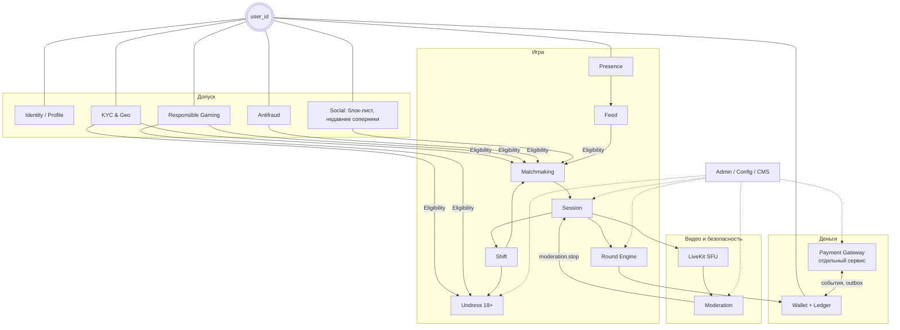
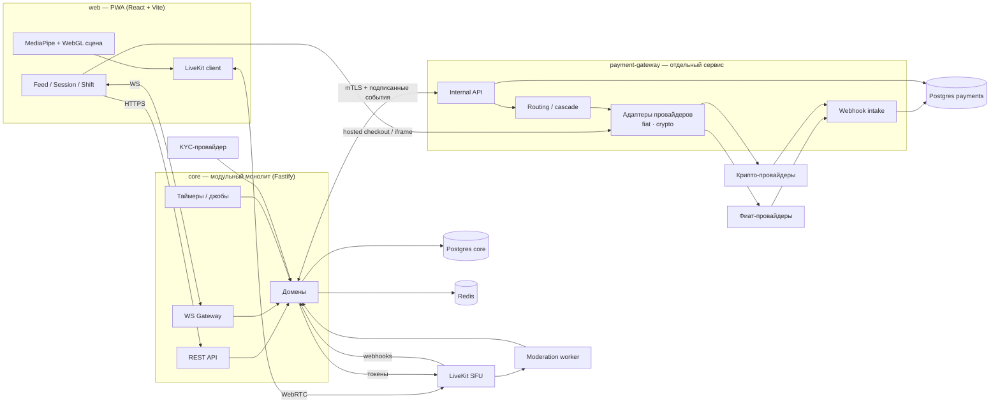
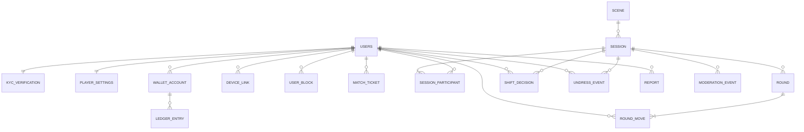
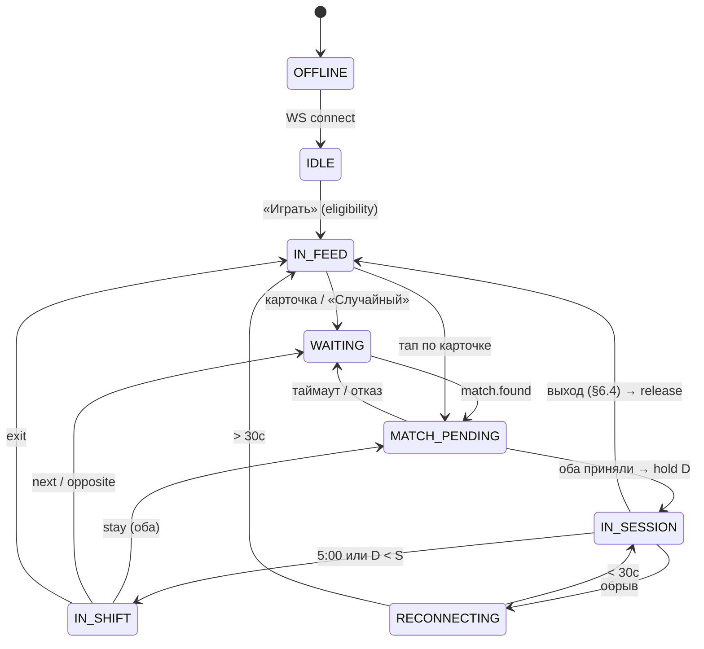
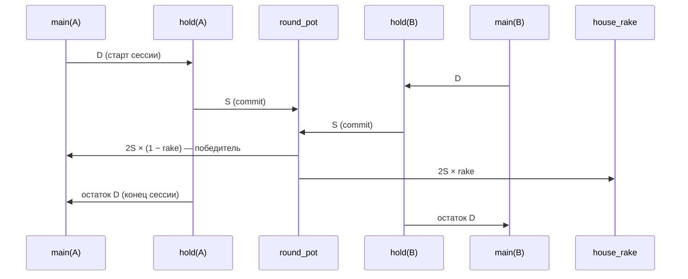

# Архитектура WinHappens Live Duel

Исходное ТЗ: [spec.md](spec.md). Платёжный шлюз: [payments.md](payments.md). План работ: [roadmap.md](roadmap.md).

## 0. Принцип: всё строится вокруг `user_id`

- `user_id` (UUIDv7) — единственный сквозной идентификатор: PK пользователя, identity участника LiveKit, WS-канал `user:{user_id}`, ключ присутствия в Redis, владелец счетов кошелька, владелец платёжных методов в шлюзе.
- **Один пользователь — одно активное состояние** (лента / очередь / сессия / смена). Закрепляется блокировкой `lock:user:{id}` в Redis и проверяется при каждом переходе.
- **Eligibility** (допуск) вычисляется из `user_id`: KYC, гео, opt-in 18+, лимиты, самоисключение, антифрод. Остальные модули только спрашивают `can_*`.
- **Деньги — только через ledger** (двойная запись) по счетам `user_id`. Поля `balance` в таблице пользователя нет.

## 1. Модули

## 2. Контейнеры

## 3. Модель данных (core)

| Таблица | Ключевые поля |
| --- | --- |
| users | id, nickname, country, status |
| kyc_verification | user_id, status, birthdate, verified_gender, provider_ref |
| player_settings | user_id, adult_opt_in, daily_loss_limit, self_excluded_until |
| wallet_account | id, user_id (null для системных), type `main / session_hold / pending_withdrawal / round_pot / house_rake / gateway_clearing`, currency |
| ledger_tx / ledger_entry | tx_id, account_id, amount (bigint, minor units), ref_type, ref_id; сумма по tx = 0 |
| device_link | user_id, kind `device / ip / payment`, fingerprint |
| user_block | user_id, blocked_user_id |
| match_ticket | id, user_id, stake, deposit, adult, gender_pref, geo, status |
| session | id, room_id, scene_id, adult_mode, started_at, ends_at, status |
| session_participant | session_id, user_id, seat, stake_S, deposit_D, hold_account_id, undress_level, stay_streak |
| round / round_move | round: id, session_id, sum, winner_seat, prize, rake, signature; move: round_id, user_id, seat, commit_hash, number, salt, stake |
| shift_decision | session_id, user_id, choice, undress, new_S, new_D |
| undress_event | session_id, user_id, level, confirmed_at |
| report / moderation_event | reporter_id, target_user_id, session_id, type, source, action, snapshot_url |

Отличия от §11 ТЗ: баланс → ledger; S/D — на участника (в 18+ ставки асимметричны); пол — только `verified_gender` из KYC.

## 4. Состояние пользователя

## 5. Поток денег в игре

## 6. Ключевые решения

1. **Commit–reveal с таймаутом reveal**: не прислал reveal за T секунд после двух коммитов — проигрыш (как выход после коммита, §6.4).
2. **Подпись результата** Ed25519; журнал раундов append-only.
3. **Серверное время** — единственный источник для всех таймеров (место 10с, сессия 300с, смена 15с, reconnect 30с).
4. **Деньги в целых minor units** (bigint), одна расчётная валюта ledger; конвертация — только на границе платёжного шлюза.
5. **Платёжный шлюз — отдельный сервис** со своей БД и секретами; core не знает о провайдерах.
6. **Модуль 18+ изолирован** и выключаем целиком (гео-флаг + KYC + opt-in обоих).

## 7. Стек

| Слой | Выбор |
| --- | --- |
| Язык | TypeScript везде (общие типы событий и DTO) |
| Монорепо | pnpm workspaces + Turborepo |
| Backend | Node.js 22, Fastify, `ws`, zod |
| БД | PostgreSQL 16, Kysely + миграции (явный SQL для ledger, `SERIALIZABLE`/`FOR UPDATE`) |
| Кэш/очереди/таймеры | Redis 7, BullMQ |
| Видео | LiveKit (self-hosted), livekit-server-sdk |
| Frontend | React + Vite, PWA, MediaPipe Selfie Segmentation, WebGL |
| Тесты | Vitest, Testcontainers (Postgres/Redis) |
| Инфраструктура | Docker Compose локально; далее k8s |
