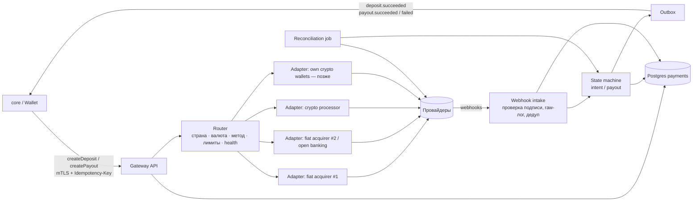
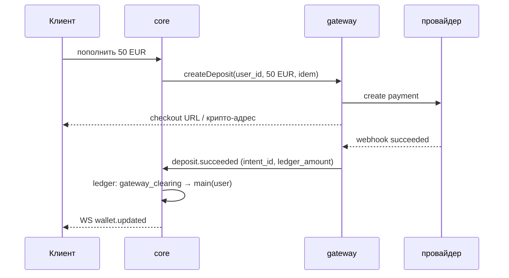

# Платёжный шлюз (payment-gateway)

Единая точка, через которую проходят **все** деньги, входящие в систему и выходящие из неё. Фиат и крипта подключаются к шлюзу как адаптеры провайдеров; core работает только с абстракциями «депозит» и «выплата».

## 1. Зачем отдельный сервис

- **Изоляция секретов и рисков**: ключи провайдеров, вебхуки, PCI/AML-зона — только здесь.
- **Независимость от провайдеров**: смена/добавление эквайера или крипто-процессинга не трогает core.
- **Маршрутизация и каскад**: если провайдер отказал — пробуем следующий.
- **Сверка (reconciliation)** с отчётами провайдеров в одном месте.

## 2. Архитектура



## 3. Интерфейс адаптера

```ts
interface PaymentProviderAdapter {
  readonly id: string;                         // 'acquirer-x', 'crypto-y'
  readonly rails: ('card' | 'bank' | 'crypto')[];
  supports(q: RouteQuery): boolean;            // страна, валюта, метод, сумма
  createDeposit(i: DepositRequest): Promise<DepositSession>;   // redirect / iframe / адрес + сумма
  createPayout(p: PayoutRequest): Promise<ProviderRef>;
  parseWebhook(raw: RawWebhook): Promise<ProviderEvent>;       // проверка подписи внутри
  fetchStatus(ref: ProviderRef): Promise<ProviderStatus>;      // для сверки и поллинга
}
```

## 4. Сущности (БД шлюза)

| Таблица | Назначение |
| --- | --- |
| payment_method | user_id, rail, токен провайдера / адрес кошелька, fingerprint (для антифрода), verified |
| payment_intent | депозит: id, user_id, amount, currency, ledger_amount, fx_quote_id, provider, status, idempotency_key |
| payout | вывод: id, user_id, amount, currency, destination (payment_method_id), status, review_status |
| provider_transaction | связь intent/payout ↔ ref провайдера, суммы, комиссии провайдера |
| webhook_event | сырой вебхук, подпись, результат обработки; уникальность (provider, event_id) |
| fx_quote | курс валюта/крипта → расчётная валюта, зафиксирован на время депозита |
| outbox | события для core, доставка at-least-once |

Статусы intent: `created → pending → succeeded | failed | expired` (+ `refunded / chargeback`).
Статусы payout: `requested → review → approved → sent → succeeded | failed`.

## 5. Связь с ledger core

Расчётная валюта ledger одна (например, USD в центах или USDT — решаем до этапа 2). Шлюз конвертирует на входе и выходе по зафиксированной котировке.



Вывод:

1. core: `main(user) → pending_withdrawal(user)` (деньги заморожены), вызов `createPayout`.
2. gateway: проверки → отправка провайдеру.
3. `payout.succeeded` → core: `pending_withdrawal → gateway_clearing`.
   `payout.failed` → core: `pending_withdrawal → main` (возврат).

Инвариант: остаток `gateway_clearing` в core совпадает с нетто по шлюзу; ежедневная сверка ловит расхождения.

## 6. Правила

- **Идемпотентность** везде: `Idempotency-Key` на API, уникальный `(provider, event_id)` на вебхуки, `intent_id` в ledger-проводке (повторная доставка не начисляет дважды).
- **Вывод только после KYC**, на метод, которым пополняли (closed loop), где возможно.
- **Ручная проверка** выплат выше порога; velocity-лимиты на пополнения/выводы.
- **Антифрод**: fingerprint платёжного метода → `device_link` в core (сговор по §13 ТЗ: общий платёжный метод у обоих → блок пары).
- **Responsible gaming**: лимиты на депозит из профиля проверяет core до вызова шлюза.
- **Инлайн-пополнение на экране Shift** (§7 ТЗ): core ставит таймер смены на паузу ≤ 60с и ждёт `deposit.succeeded` по WS.
- **Крипта**: подтверждения сети настраиваются по монете; недоплата/переплата → частичное зачисление по правилам; адрес на депозит — одноразовый.
- **Chargeback** (фиат): событие → core списывает с main, при нехватке — отрицательный баланс и блок вывода.

## 7. Открытые вопросы

- Расчётная валюта ledger: USD или USDT?
- Первые провайдеры для MVP: какой фиат-эквайер и какой крипто-процессинг (зависит от юрисдикции лицензии).
- На старте — один провайдер каждого типа и mock-адаптер для разработки; каскад — после MVP.
